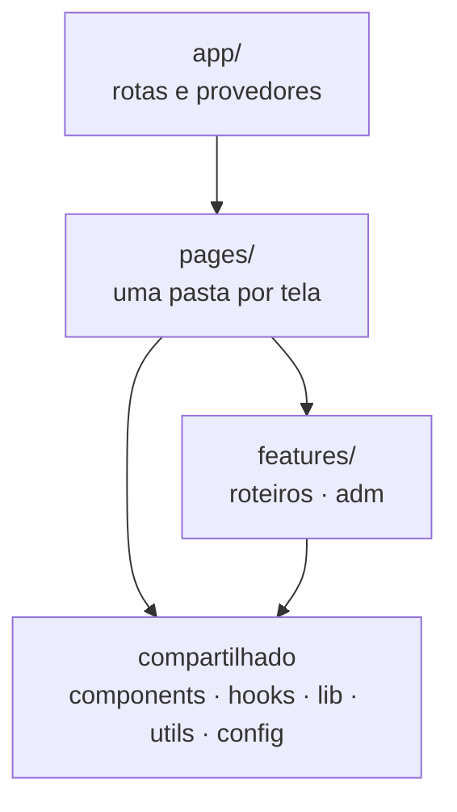

# Fábio Cicloturismo: Frontend

Site de viagens de bike: catálogo de roteiros, área do cliente e compra de passeios, mais o painel do ADM.

**Stack:** React 19 · TypeScript · Vite · Tailwind CSS 4 · React Router 7 · Vitest + Testing Library · oxlint · Prettier

## Rodando localmente

Requer Node.js 22 ou superior (a versão usada fica em `.nvmrc`).

```bash
cd frontend
npm install
npm run dev      # http://localhost:5173
```

| Comando                 | O que faz                                                         |
| ----------------------- | ----------------------------------------------------------------- |
| `npm run dev`           | Servidor de desenvolvimento                                       |
| `npm run build`         | Checagem de tipos + build de produção em `dist/`                  |
| `npm run preview`       | Serve o build localmente                                          |
| `npm run check`         | Tudo o que a CI confere: tipos, lint, formatação e testes         |
| `npm run typecheck`     | Checagem de tipos                                                 |
| `npm run lint`          | Lint com oxlint (avisos também reprovam)                          |
| `npm run format`        | Formata o código com Prettier (ordena imports e classes Tailwind) |
| `npm test`              | Roda os testes uma vez                                            |
| `npm run test:watch`    | Roda os testes a cada alteração                                   |
| `npm run test:coverage` | Testes com relatório de cobertura em `coverage/`                  |

A cada pull request que mexe no frontend, o GitHub Actions roda `typecheck`, `lint`, `format:check`, os testes e o build
(`.github/workflows/frontend.yml`).

### Conectando à API

Sem configuração, o site mostra os dados de exemplo de `src/features/roteiros/data/roteirosExemplo.ts`. Para usar a API
(pasta `backend/`), copie `.env.example` para `.env.local` e defina `VITE_API_URL` com o endereço dela. Na Vercel, a
mesma variável vai em _Settings → Environment Variables_. A API precisa liberar a origem do site em `APP_CORS_ORIGENS`.

A conversão do formato da API para o das telas fica em `src/features/roteiros/api/adaptadorRoteiro.ts`.

## Arquitetura

O código é organizado **por domínio**. Cada domínio (`features/`) reúne tudo o que é dele: chamadas à API, tipos, regras,
hooks e componentes. As páginas (`pages/`) só montam as telas a partir dos domínios e dos componentes compartilhados.



As setas só vão para baixo: um domínio não conhece as páginas, e o compartilhado não conhece nenhum domínio. O painel do
ADM depende do domínio de roteiros (para reaproveitar os nomes de nível e paisagem), nunca o contrário.

```
src/
├── app/                        inicialização: provedores, mapa de rotas e o limite de erro do site
├── features/                   domínios do negócio
│   ├── roteiros/               catálogo público
│   │   ├── api/                busca na API e adaptador do formato da API para o das telas
│   │   ├── components/         IndicadorNivel, ErroNoCatalogo
│   │   ├── config/             níveis de dificuldade e paisagens
│   │   ├── data/               roteiros de exemplo (quando o site roda sem API)
│   │   ├── hooks/              useRoteiros
│   │   ├── utils/              perfil altimétrico e filtros de saídas
│   │   ├── types.ts
│   │   └── index.ts            API pública do domínio
│   └── adm/                    painel do ADM
│       ├── api/                cliente da API do painel (já com o token)
│       ├── components/         ui/ (Botao, campos, Cartao...), roteiros/ e saidas/
│       ├── config/             rótulos e cores de status, grupos, modalidades
│       ├── hooks/              useEstadoDaNavegacao
│       ├── sessao/             contexto, provedor e armazenamento do token
│       ├── utils/              conversão e validação do formulário de roteiro
│       ├── types.ts            formatos da API do ADM
│       └── index.ts            API pública do domínio
├── pages/                      uma pasta por tela, carregada sob demanda
│   ├── Inicio/  Roteiros/      cada uma com components/ próprios
│   ├── Sobre/  Contato/  MinhaConta/  Cadastro/  NaoEncontrada/
│   └── Adm/                    telas do painel (Entrar, Painel, Roteiros, Roteiro, Saida), num pacote separado
├── components/                 componentes compartilhados, sem regra de negócio
│   ├── feedback/               carregando, erro, 404, página em construção, Error Boundary
│   ├── icones/
│   ├── layout/                 LayoutPrincipal, Cabecalho/, Rodape/
│   └── ui/                     Container, Logo, Selo, TituloSecao, estilos de botão...
├── hooks/                      hooks genéricos (useRecurso, rolagem, título da aba...)
├── lib/                        cliente HTTP da API (requisitar, ErroApi)
├── utils/                      funções puras genéricas (formatação, cn)
├── config/                     dados editáveis do site (empresa, menu)
├── constants/                  caminhos das rotas
├── styles/global.css           Tailwind + tema (cores, fontes e variantes de altura)
├── test/                       configuração e fábricas de dados dos testes
└── types/                      tipos compartilhados entre camadas
```

## Convenções

- **Importe um domínio pela API pública dele**: `import { useRoteiros } from '@/features/roteiros'`, nunca de um arquivo
  interno (`@/features/roteiros/hooks/...`). Uma página também não importa os arquivos de outra. O lint (`no-restricted-imports`)
  reprova as duas coisas.
- **Onde colocar cada coisa**: usado por uma tela só → `pages/<Tela>/`. Regra ou componente de um domínio →
  `features/<dominio>/`. Genérico, sem regra de negócio → `components/`, `hooks/` ou `utils/`.
- **Lógica fora do componente**: conversões, validações e cálculos ficam em funções puras (`utils/`), testadas sem
  desenhar nada. O componente só liga estado e tela (veja `FormularioRoteiro` e `utils/formularioRoteiro.ts`).
- **Estados de carregamento** com `useRecurso`, que devolve `carregando | erro | pronto` e cancela a requisição anterior.
- **Classes**: junte com `cn()`. Um componente oferece variantes (`tamanho`, `tom`, `variante`) e quem o usa só acrescenta
  o que é do lugar (margem, largura); ninguém sobrescreve uma classe da receita. Assim o resultado não depende da ordem
  das classes.
- **Cores e fontes** só pelos tokens do `@theme` em `styles/global.css` (`vermelho-*`, `sol-*`, `verde-*`, `carvao-*`,
  `creme-*`, `alerta-*`, `rampa-*`), nunca com hexadecimal no componente.
- **Rotas** sempre pelas constantes de `constants/rotas.ts`, nunca com o caminho escrito à mão.
- **Textos e dados da empresa** (e-mail, telefone, menu) ficam em `config/`, não espalhados pelos componentes.
- **Nomes em português** para páginas, componentes e funções do domínio (`Cabecalho`, `MinhaConta`, `linksNavegacao`).
- **Imports absolutos** com `@/`. A ordem dos imports e das classes Tailwind é mantida pelo Prettier.

### Testes

Ficam ao lado do que testam (`perfil.ts` → `perfil.test.ts`). Lógica pura roda direto no Node; testes que desenham na
tela começam com `// @vitest-environment jsdom`. As fábricas em `src/test/fabricas.ts` montam dados válidos, e cada
teste troca só o que importa para ele. `app/Rotas.test.tsx` abre cada página de verdade, para pegar erros que a
checagem de tipos não vê.

### Adicionando uma página

1. Crie `src/pages/NovaPagina/NovaPagina.tsx` e `src/pages/NovaPagina/index.ts` (`export { NovaPagina as default } from './NovaPagina'`).
2. Adicione o caminho em `src/constants/rotas.ts`.
3. Registre a rota em `src/app/Rotas.tsx` e um caso em `src/app/Rotas.test.tsx`.
4. Se ela aparecer no menu, adicione em `src/config/navegacao.ts`.

## Responsividade

Mobile first, com os breakpoints padrão do Tailwind:

- **Celular (< 768px):** menu hambúrguer em tela cheia, com o botão "Entrar" dentro do menu.
- **Tablet/desktop (≥ 768px):** menu horizontal e botão "Entrar" no cabeçalho.

Além da largura, a página inicial se adapta à **altura** da janela, com as variantes definidas em `styles/global.css`:
`baixa` (até 860px, notebooks e celulares comuns), `mini` (até 700px) e `curta` (até 600px, celulares bem baixos). A
vitrine das próximas saídas calcula a própria altura para o título, os filtros e a faixa de números caberem juntos na tela.

## Imagens

`public/images/hero-bikepacking.jpg`: foto de Patrick Hendry no [Unsplash](https://unsplash.com/photos/1ow9zrlldJU), sob a Licença Unsplash (uso gratuito, inclusive comercial).
